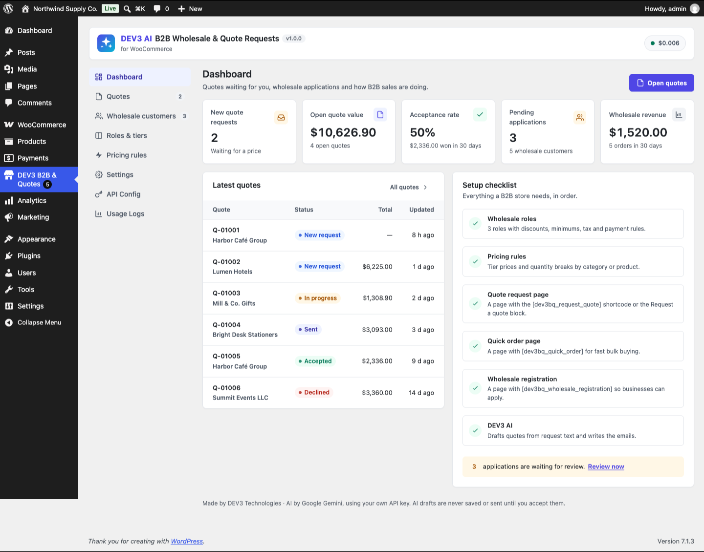

# DEV3 AI B2B Wholesale & Quote Requests for WooCommerce

Wholesale roles, tiered B2B pricing, quick order and request-a-quote for WooCommerce, with DEV3 AI quote drafts from free-text requests.



## Features

One plugin for both halves of B2B selling: wholesale pricing and priced quotes.

**Wholesale**

* Any number of wholesale roles (tiers) with a default discount, minimum order value and quantity, tax exemption, allowed payment and shipping methods, a free-shipping threshold and their own price label.
* Registration form (shortcode + block) with manual or automatic approval and WooCommerce emails for every step.
* Pricing rules for everyone, every wholesale role or one role, by product or category, with quantity breaks (percent off, amount off or fixed unit price), priorities and start/end dates.
* Product-level prices and breaks per role, wholesale-only or retail-only products, minimum quantity and pack size.
* Hide prices from guests, struck-through retail prices, a "Buy more, save more" table on product pages.
* Payment and shipping methods per role (classic and block checkout).
* Quick-order table (shortcode + block) with search, categories, role prices, quantity tiers and a "paste a list" box.

**Request a quote**

* "Add to quote" on product pages and in the quick-order table, "Request a quote for this cart" on the cart, a quote page with a free-text request.
* Admin quote editor: lines priced by your rules, overrides, shipping, discount, tax mode, validity, terms, messages and a timeline.
* PDF quotes, email with the PDF, a private customer link (or My Account → Quotes), Accept / Decline / message.
* Accept creates a pending WooCommerce order with exactly the quoted prices and a pay link (HPOS compatible).
* Automatic reminders and expiry.

**DEV3 AI (optional, your own Google AI key)**

* Draft a quote from the customer's free-text request: real catalogue products only, prices always from your rules.
* Write cover, follow-up, reply, decline and expiry emails.
* Screen wholesale applications with plain-language signals.
* Let shoppers turn a pasted list into products (rate-limited, cached, with a non-AI fallback).

Every AI result is a draft that you accept, edit or reject. The plugin is fully usable without AI.

## Requirements

- WordPress 6.0 or newer (tested up to 6.8)
- PHP 7.4 or newer
- WooCommerce 8.0 or newer (required)
- Optional: your own Google AI API key (from Google AI Studio) to switch on the DEV3 AI features. The rest of the plugin works without one.

## Installation

### From the release zip

1. Download `dev3-ai-b2b-wholesale-for-woocommerce.zip` from the [latest release](https://github.com/dev3tech/dev3-ai-b2b-wholesale-for-woocommerce/releases/latest).
2. In WordPress, go to **Plugins → Add New → Upload Plugin**, choose the zip and click **Install Now**.
3. Click **Activate**.

### Build from source

```bash
git clone https://github.com/dev3tech/dev3-ai-b2b-wholesale-for-woocommerce.git
cd dev3-ai-b2b-wholesale-for-woocommerce
composer install --no-dev
npm ci
npm run build
```

Then copy the `dev3-ai-b2b-wholesale-for-woocommerce` folder into `wp-content/plugins/` and activate it.

### Getting started

1. Upload the plugin zip in Plugins → Add New → Upload, then activate it (WooCommerce must be active).
2. Open **DEV3 B2B & Quotes → Settings** and create the quote, quick-order and registration pages with one click.
3. Review the default roles in **Roles & tiers** and add pricing rules.
4. Optional: add a Google AI API key in **API Config** to turn on DEV3 AI.

## FAQ

### Does it work with the Cart and Checkout blocks?
Yes. Prices, minimums, tax exemption and payment/shipping rules apply to both the classic and the block checkout.

### Is it compatible with HPOS?
Yes. Orders are only created and read through the WooCommerce CRUD API.

### Can the AI invent prices or products?
No. The AI only picks from catalogue products the plugin found for the request; any other id is dropped, and every price comes from your pricing rules.

### What data is sent to Google?
Only when you press a DEV3 AI button: the request text and a list of matching product names/SKUs, or quote facts without addresses, or application details. Storefront list matching sends the shopper's list and product names.

## Documentation

The full HTML guide (installation, settings, hooks and FAQ) is in [`docs/index.html`](docs/index.html). Open it in a browser after cloning or downloading the repository.

## Changelog

### 1.0.1 (unreleased)
* Fix: category and product names containing "&" (e.g. "Mugs & Drinkware") showed as HTML entities in the pricing rules table, rule editor, quick order filter and DEV3 AI prompts. Names are now sent as plain text, including names that were stored escaped twice.

### 1.0.0
* Initial release.

## Licence

Released under the GNU General Public License v2.0 or later (GPL-2.0-or-later). See [LICENSE](LICENSE).

## More from DEV3

- [DEV3 AI B2B Wholesale & Quote Requests for WooCommerce on the DEV3 Marketplace](https://www.dev3.tech/item/dev3-ai-b2b-wholesale-for-woocommerce)
- [More WordPress plugins, themes and templates from DEV3](https://www.dev3.tech/marketplace)
